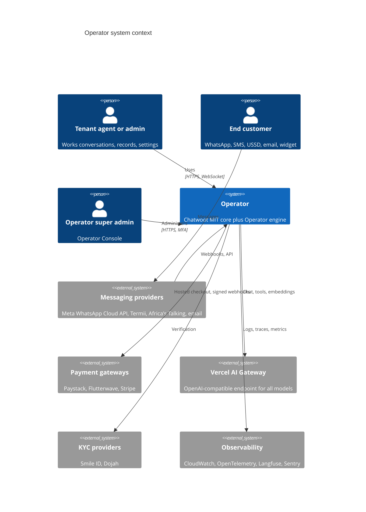
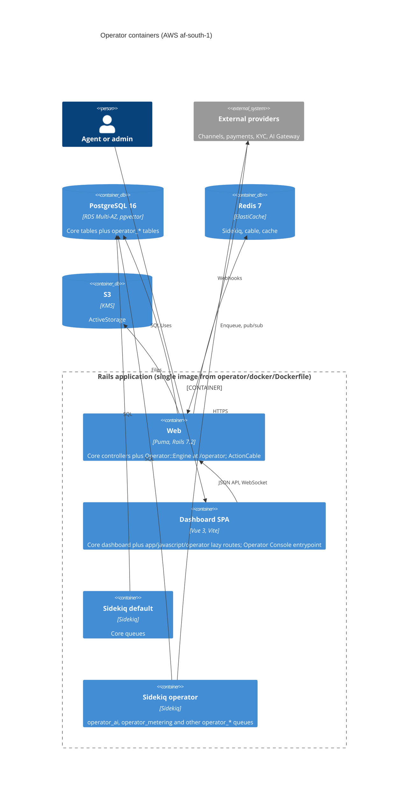

# Architecture overview

## Context

Operator is a commercial, multi-tenant, resellable customer-operations platform. It is a Rails engine in `operator/` on a fork of Chatwoot's MIT core (upstream `843385ff3a`, v4.18.0). Chatwoot supplies the omnichannel inbox, contacts, conversations, automations, help centre and widget; Operator adds tenancy and billing, clean-room enterprise parity, Operator AI, the Records engine, industry packs and Africa integrations. Launch market Nigeria, hosted in AWS af-south-1. `enterprise/` is removed (ADR 0003).

## Containers

## The engine

| Concern | Mechanism | Reference |
|---|---|---|
| Loading | `Gemfile` line `eval_gemfile 'operator/Gemfile.operator'` (OT-001); `Bundler.require` loads the engine | ADR 0001 |
| Namespace | `isolate_namespace Operator`; tables `operator_*`; everything prefixed | ADR 0002 |
| Routes | Engine mounted at `/operator` via `routes.append`; core routes win; one `routes.prepend` block of tombstone 404s | ADR 0005 |
| Migrations | `operator/db/migrate` appended to app migration paths | ADR 0001 |
| Schedules | `operator/config/schedule.yml` into sidekiq-cron with `source: 'operator'` | ADR 0001 |
| Frontend | `app/javascript/operator/` via `operator/` alias; lazy routes spread into core route files | OT-002, OT-007 |
| Config | Rebrand and install settings through InstallationConfig (`OPERATOR_*` keys) | ADR 0002 |
| Tenancy | Core `Account`; `account_id NOT NULL` everywhere; Pundit `policy_scope` | ADR 0006 |

## Seams

Core behaviour changes only through `prepend` entries in `operator/lib/operator/seams.rb`, applied in `config.to_prepare`. Each seam module (`Operator::Seams::<CoreClass>Ext`) is at most 30 lines, delegates to an Operator service and calls `super` otherwise. Each has a guard spec. The Seam Register under `generated/` is produced from `seams.rb` (planned). Edits that a prepend cannot make are one-line core touches logged in [`../upstream-touches.yml`](../upstream-touches.yml).

Seam targets in v0 (plan section 2.2): `Account`, `Inbox#active_bot?`, `AgentBotListener`, `SyncDispatcher#listeners`, `AsyncDispatcher#listeners`, `SendReplyJob#perform`, `HookListener#supported_hook_event?`, `HookJob#perform`, `Integrations::App`, `Webhook#validate_webhook_subscriptions`, `Channel::Sms`, `Twilio::CallbackController`, `Webhooks::SmsController`, `DashboardController#app_config`, `ChatwootHub`, `Llm::Config`, `Llm::Models`, `AutoAssignment::AssignmentService`, `Captain::BaseTaskService`, `TriggerScheduledItemsJob`.

## Flows between core and Operator

| Flow | Path |
|---|---|
| Request (Operator API) | Client -> `/operator/...` -> `Operator::Engine` controller -> `Current.account` + Pundit -> Operator service -> `Operator::Result` -> RFC 9457 or JSON |
| Request (core API) | Client -> core controller -> core model; Operator effects only through seams (for example `Account#all_features` merging `operator_account_flags`, `usage_limits` from entitlements) |
| Core event to Operator | Core `Dispatcher` -> `SyncDispatcher`/`AsyncDispatcher#listeners` seam appends `Operator::Listeners::*` -> listener enqueues an `operator_*` job after commit |
| Inbound message to AI | Channel webhook -> core message created -> `AgentBotListener` seam routes `operator_ai` bots -> `Operator::AI::TurnDebounceJob` (3 s) -> locked turn job on `operator_ai` -> `Operator::AI::Runtime.call` -> AI Gateway -> reply through core message APIs |
| Outbound reply | Core `SendReplyJob` seam resolves Operator channel services first, else core `CHANNEL_SERVICES`; `Channel::Sms` seam dispatches by `provider` to Termii or Africa's Talking |
| Provider webhook | `/operator/...` webhook controller -> signature over raw body -> `operator_inbound_events` (unique) -> ack under 1 s -> async job |
| Operator event out | `operator.<module>.<past_tense_verb>` -> core webhooks (validator seam accepts Operator events) and ActionCable |
| Schedules | sidekiq-cron (`source: 'operator'`) and `TriggerScheduledItemsJob` seam for follow-ups and hold expiries |

## Layering inside the engine

Bounded contexts `kernel` (tenancy, flags, config, results, safe HTTP), `platform` (billing, AI, records, channels, parity features, compliance) and `packs` (real estate, hospitality, travel, Africa). Dependencies point packs -> platform -> kernel -> core only, enforced by the boundary spec (planned).
